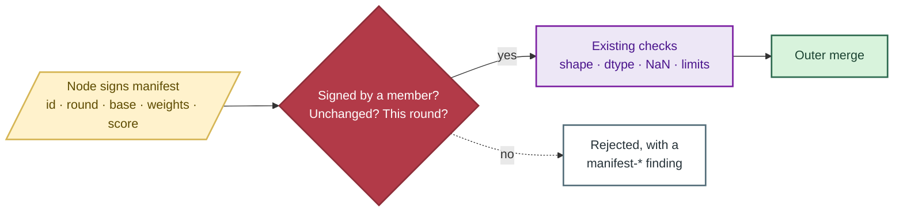

# Signed Contribution Manifests

| Field       | Value                     |
| :---------- | :------------------------ |
| Status      | Implemented in `contrib/` |
| Confidence  | Medium (3/5)              |
| Created     | November 25, 2026         |
| Last Update | November 25, 2026         |

This note records the design of signed contribution manifests, added to the contribution validator in [#344](https://github.com/The-AI-Alliance/tapestry/pull/344) for issue [#273](https://github.com/The-AI-Alliance/tapestry/issues/273). It covers one part of the model-update validation in [Infrastructure Requirements](infrastructure-requirements.md#model-update-validation): "trusted hash, authenticated provenance, submitter identity, and signatures where appropriate." For the API, the finding codes, and how to run it, see the [validator README](../../../contrib/build4me2-contribution-validator/README.md#signed-manifests).

## Why

The contribution validator is the check that runs on each node's update before it is merged into the shared model. Since [#254](https://github.com/The-AI-Alliance/tapestry/pull/254), a node can declare a fingerprint of the shared base it trained from, and the validator rejects an update whose declared base is not the current one. That declaration is a plain field. Anyone can copy the right value onto any weights: a node outside the consortium, someone using a member's name, or someone changing a member's update on the way. Before signed manifests, the validator accepted all of these.

## What

Each node signs a short statement about its update, the manifest. It names the sender, the round, the base the node trained from, a fingerprint of the contributed weights, and the quality score and token count that merge weights can depend on. The coordinator holds a roster of each member's public key. With a roster, it admits an update only if a member signed it for the current round and nothing in the manifest or the weights changed afterwards. Each kind of failure is recorded as its own validation finding in the round summary. Without a roster, nothing changes.

## How it works

The coordinator checks a manifest in this order:

1. **A signed manifest is present.** Otherwise the update is rejected as `manifest-missing`.
2. **The sender is on the roster.** Otherwise `manifest-signer-unknown`.
3. **The signature verifies with that member's key.** This fails if anyone other than the member signed it, or if the manifest changed after signing. Otherwise `manifest-signature-invalid`.
4. **The signed manifest matches what arrived.** The sender, the weights' fingerprint, the quality score, and the token count must match the update, the round must be the one being run, and the base must be the current shared base. Each field that differs is a separate `manifest-mismatch`.

The first three checks stop at the first failure, because a manifest that does not verify says nothing trustworthy. The validator's other checks (shape, dtype, non-finite values, update limits) still run, so the report lists every problem with the update.

An empty roster rejects every update. A manifest that cannot be encoded, such as one with a NaN score, is rejected with a finding instead of stopping the round. A validator given a roster refuses to check a bare model state, because a bare state has no manifest to check.

## Design choices

These were open questions in #273. Each is a choice the implementation makes, and each can be changed.

- **Ed25519 signatures,** from the `cryptography` package. The standard library cannot sign, and Ed25519 keys and signatures are small and fast to verify.
- **The round is signed,** so a recorded update cannot be replayed in a later round, even one whose base did not change.
- **The quality score and token count are signed,** because they can set the update's weight in the merge. Changing them after signing would change the member's influence without its consent.
- **The signed bytes are compact JSON with sorted keys and a format tag** (`tapestry-contribution-manifest/1`). The tag ensures a signature over a manifest cannot be valid for any other message signed with the same key, and its version changes whenever the manifest fields change.
- **The roster is fixed when the coordinator is built** and trusted as given.

## What it does not do

A signature proves who made a claim, not that the claim is true. A member that trains from the wrong base and signs the correct base fingerprint is still admitted, but the false claim now carries its signature, so it can be attributed to that member. A test pins this behaviour.

Signed manifests do not detect poisoned or backdoored updates, and they say nothing about the data an update was trained on.

## Open questions

- **Key distribution, rotation, and revocation.** The roster is supplied by whoever builds the coordinator. Where keys come from, and how a member replaces a lost or compromised key, belongs with the central node work in [#114](https://github.com/The-AI-Alliance/tapestry/issues/114).
- **Carrying manifests between nodes.** Today the manifest travels inside the in-process contribution object. A wire format belongs with the message protocol in [#126](https://github.com/The-AI-Alliance/tapestry/issues/126) and [#282](https://github.com/The-AI-Alliance/tapestry/issues/282). The signed bytes are Python's JSON encoding, so a node written in another language would have to reproduce them exactly; a standard canonical form may fit the protocol better.
- **Relationship to the authenticated ingress.** [TAP-011](../../architecture/decisions/adr-011-central-node-infrastructure.md) item 5 asks for one mutually-authenticated ingress per member, with an explicit member allow-list. That authenticates the connection; a signed manifest authenticates the update itself, wherever it travels. The two lists of members should probably be keyed on the same identity, so a member admitted at the ingress is the member whose signature is checked.
- **Who the roster belongs to.** Admission to the consortium is a governance decision, not the coordinator's. The threat-modeling proposal in [#337](https://github.com/The-AI-Alliance/tapestry/issues/337) covers this boundary more broadly.
